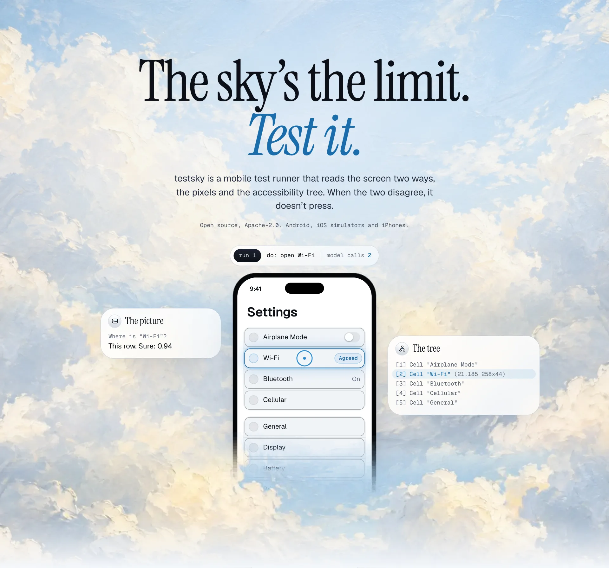
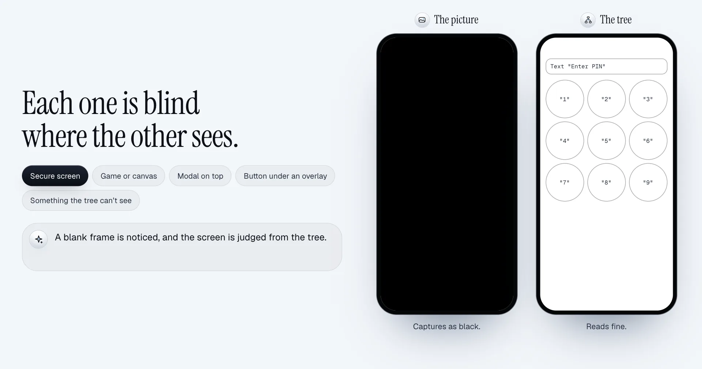
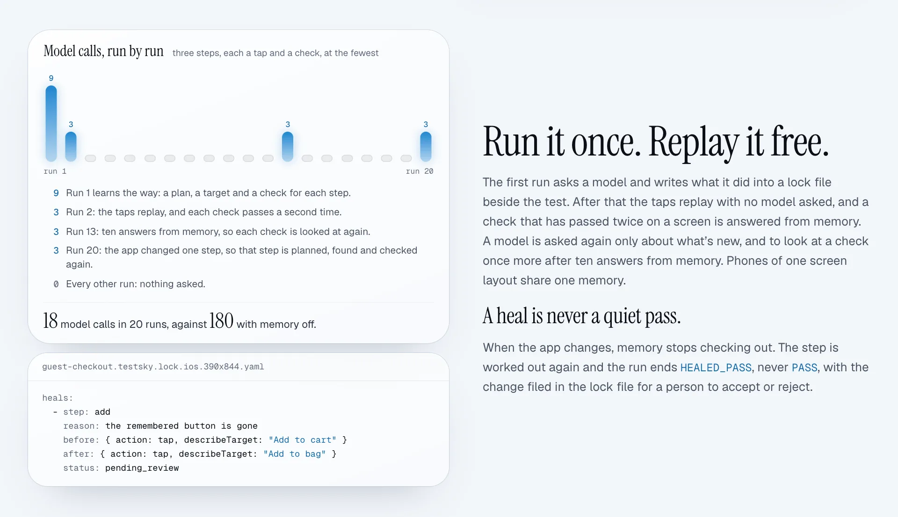
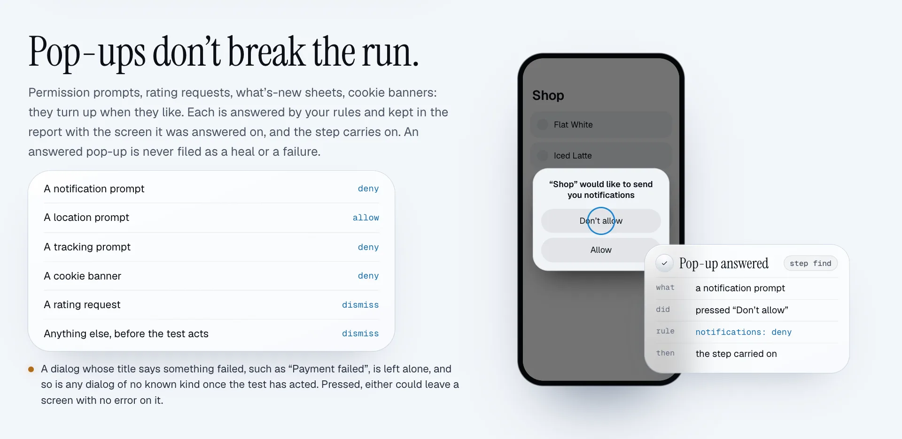
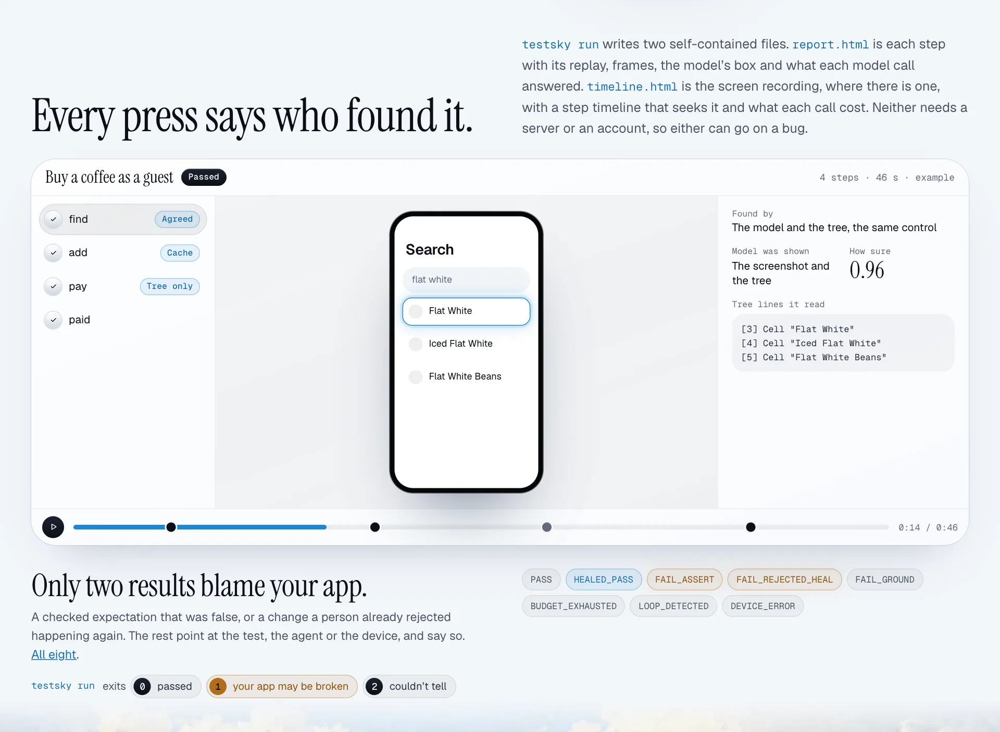

<p align="center">
  <a href="https://testsky.vercel.app">
    <picture>
      <source media="(prefers-color-scheme: dark)" srcset="assets/brand/readme-top-night.webp">
      
    </picture>
  </a>
</p>

<h1 align="center">testsky</h1>

<p align="center">
  <b>Mobile tests in plain words, on Android and iOS.</b><br>
  It reads every screen two ways, the pixels and the accessibility tree,
  and when the two disagree, it doesn't press.
</p>

<p align="center">
  <a href="https://www.npmjs.com/package/@zybo/testsky"></a>
  <a href="LICENSE"></a>
  
  
  <a href="https://testsky.vercel.app/docs"></a>
</p>

<p align="center">
  <a href="https://testsky.vercel.app">Website</a> ·
  <a href="https://testsky.vercel.app/docs/quick-start">Quick start</a> ·
  <a href="https://testsky.vercel.app/docs">Docs</a> ·
  <a href="#from-an-agent-or-a-script">Agents and MCP</a> ·
  <a href="CONTRIBUTING.md">Contributing</a>
</p>

## A test

A test is a YAML file beside your code, one file for both platforms, in the
words a person would use. There are no selectors: where to press is
testsky's to decide.

```yaml
id: guest-checkout
title: Buy a coffee as a guest
targets:
  - { platform: android, app: com.example.shop }
  - { platform: ios, app: com.example.Shop }
setup:
  - launch app
steps:
  - id: find
    do: search for "flat white"
    expect: the results list "Flat White"

  - id: add
    do: open "Flat White" and add it to the cart
    expect: the cart shows 1 item

  - id: pay
    do: type "4242 4242 4242 4242" as the card and tap Pay

  - id: paid
    expect: the screen says the order is confirmed
    within: 45s
    extract:
      order: the order number, as written
teardown:
  - terminate app
```

| Key | What it says |
|---|---|
| `do` | What to do. The planner copies a quoted name exactly and does nothing the step does not ask for; what it types is read back from the tree. |
| `expect` | What must be true afterwards, judged on the screen the step left. |
| `within` | How long that may take. It is looked at until then, and a model is asked again only when the screen has changed. |
| `extract` | A value to read off the screen, in your words. |

Every key is in [the test file](https://testsky.vercel.app/docs/test-file)
and [steps](https://testsky.vercel.app/docs/steps) docs. Manual cases
already written? `testsky import` drafts tests from a Jira, Xray or TestRail
CSV export.

## Quick start

You need:

- **Node.js 22.18 or newer.**
- **A phone:** an Android phone with USB debugging or an emulator, through
  adb; an iOS simulator, through Xcode; or an iPhone whose WebDriverAgent is
  already running and forwarded. testsky does not sign or start one.
- **A vision model you bring,** behind any OpenAI-compatible endpoint: a
  cloud gateway or a local server (vLLM, ollama).

Install it with npm or pnpm:

```bash
npm install -g @zybo/testsky
# or
pnpm add -g @zybo/testsky
```

pnpm 10 and later list `sharp` and the ffmpeg installer under "Ignored build
scripts"; testsky runs without them. Then:

```bash
export TESTSKY_MODEL_BASE_URL=... TESTSKY_MODEL_NAME=... TESTSKY_MODEL_API_KEY=...
testsky doctor        # does it see a phone, and does the model answer -- and land on target
testsky run settings-smoke.testsky.yaml --platform ios   # examples/settings-smoke.testsky.yaml
```

Or run it from a clone, with pnpm. testsky runs its TypeScript as it is, with
no build, and each `testsky` command below becomes `pnpm testsky`
(`pnpm -s testsky` with `--json`):

```bash
git clone https://github.com/zubeyralmaho/testsky.git && cd testsky
pnpm install
pnpm testsky run examples/settings-smoke.testsky.yaml --platform ios
```

The key stays in your environment: the `TESTSKY_MODEL_*` variables, a
`.env` where you run testsky, or a variable that `~/.testsky/models.yaml`
names ([examples/models.yaml](examples/models.yaml)). In a clone,
`pnpm typecheck` and `pnpm test` run without a device or a model.

## Why two ways

<picture>
  <source media="(prefers-color-scheme: dark)" srcset="assets/brand/readme-blind-night.webp">
  
</picture>

Each source is blind exactly where the other one sees:

| Screen | Pixels | Tree |
|---|---|---|
| Secure screens (`FLAG_SECURE`, DRM video, payment PINs) | capture as black | read fine |
| Canvas, games, some onboarding flows | read fine | empty or unlabelled |
| A long list, target far below the fold | many model round trips | one lookup |
| A modal over the target | a model may answer past it | the modal is in the tree |
| A button under an overlay | a tap "succeeds" and nothing changes | the overlay is in the tree |

A vision-only agent such as Midscene inherits the first column. testsky uses
Midscene's device layer (screenshots, input, uiautomator dumps) and does its
own perception, grounding, planning and judging.

On Android, `TESTSKY_ANDROID_ENGINE=agent` swaps Midscene's device layer for
testsky's own agent: a small jar that `app_process` runs on the phone, over
one socket, with no app installed and nothing left behind. On one phone it
took a picture in 0.1 s and read the tree in 20 ms, where `screencap` took
1.2 s and a uiautomator dump 2.3 s. It is new, so Midscene stays the default
until the agent has run on more phones.

## Finding a target

Both sources look every time, from one capture:

- **The model** is shown the screenshot with the tree beside it and points
  at the element.
- **The tree** names a target on its own only when the description's words
  are the name of exactly one pressable control on the screen -- its label,
  its id, or a phrase in quotes, with words like "button" or "butonu" set
  aside -- and nothing is drawn over it. A description that says more than
  a name (the switch next to "Wi-Fi") is left to the model; one that asks
  for a kind gets that kind (the Wi-Fi switch is the one switch in the
  Wi-Fi row, never the row). Nothing hidden, half off the screen, below a
  field being typed into (Android's tree has no keyboard) or on a tree cut
  short.

A target is pressed when the two agree on the control, at the tree's exact
centre of it -- or at the model's point when the model's box, around what it
can see of the control, leaves that centre out. When the tree names nothing,
the model's answer is used, measured by the tree when its box is a control's
box. When the model looks and says the element is not there, nothing is
pressed, whatever the tree says: something the tree does not show is over
it. The tree decides alone only when there is no picture to look at, such as
a secure screen that captures black; a model that cannot be asked fails the
run rather than leave the press to the tree. When they disagree, the model is
asked again and told where the tree's control is; if they still disagree,
nothing is pressed and the step plans again knowing both. A step with
`channel: vision` leaves the tree out.

<details>
<summary><b>Doing what the step says</b>: typing, moved screens, waits</summary>

- The planner names targets in the step's own words and copies a quoted
  name exactly; it types the step's text character for character, and does
  nothing the step does not ask for.
- A field ends up holding exactly what was typed: what was in it goes first,
  unless the step says to add to it. What it holds is read back from the
  tree; a field holding something else is typed into once more, and if it
  still does, the step is told and the report says so. A keyboard that only
  changed the case is said, not fought. There are no secret steps: a report
  shows everything a run typed.
- A plan made for a screen that has moved on is made again on the new one,
  not carried out there. A tree that cannot be read leaves the picture to
  find the target, and is not reported as a broken app.
- `wait: 30s` lets that much time pass, with no model asked, and then checks
  the step's `expect` if it has one: a soak, where the time itself is the point.
  An agent told to "wait 30 seconds" answered with a wait of one.
- `within: 45s` on an expectation is the author's word for how long it
  takes -- a network joined, a page loaded. It is looked at until then, and
  put to a model only when the question has changed since its last answer:
  the picture to the pixel, or any word the tree shows. A still screen costs
  one call for the whole wait, a changing one a call every few looks, and one
  whose tree turns from disagreeing to agreeing with it is judged at once. The
  tree is read to see the change and never shown to the judge; what held is
  looked at once more; the screen at the deadline is judged. The agent's own
  waits, up to that time, are no loop and cost it no moves -- it keeps the
  turn, and can press Skip the moment an ad offers it. Not holding in time is
  the app's failure; the test running out of time first is not. A wait is
  never shorter than the grace any expectation gets.

</details>

## Memory and heals

<picture>
  <source media="(prefers-color-scheme: dark)" srcset="assets/brand/readme-cost-night.webp">
  
</picture>

What a run learned is kept beside the test, one lock file per platform and
screen layout (`checkout.testsky.lock.ios.390x844.yaml`), and replayed by the
next run with no model asked. When a remembered target stops checking out,
the step is worked out again; if it passes, the run ends `HEALED_PASS`, the
new way is what the next run replays, and the change is filed under the
lock's `heals` with `status: pending_review`.

A review is an edit of that status. The next `testsky run` acts on it before
anything is replayed, and says so on the console:

- `rejected`: the step's memory goes back to the old target, or, where that
  cannot be done exactly, the step is worked out again. The same change again
  fails the run `FAIL_REJECTED_HEAL`, which blames the app; once the app is
  fixed, the old target passes again.
- `accepted`: the change was the app's, and the memory already holds it.

A word acted on is marked `applied:` beside it, and is not acted on again, so
a later run does not undo what the memory has learned since; that field is
testsky's own. A word changed later is acted on in its turn: a rejection
turned into an acceptance puts the new target back. A status set back to
`pending_review` takes the word back and nothing more: the memory stays where
the word left it -- after a rejection, on the old target -- so an app that
still shows the change is healed again, `HEALED_PASS` and up for review,
rather than a substitute nobody accepted replayed as a `PASS`.

A heal of `kind: astray` is a memory that went somewhere its step does not
name, and the step failed. A word on one is acted on at the step instead:
accepted, that memory is forgotten and the step worked out again; rejected,
the press was the step's, and the failure after it is the app's.

## Pop-ups

<picture>
  <source media="(prefers-color-scheme: dark)" srcset="assets/brand/readme-popups-night.webp">
  
</picture>

A pop-up is not part of the step. It is answered by a rule, the press is never
remembered, it is never filed as a heal or a failure, and the report shows it
with the screen it was answered on. Unless a test's `policy.popups` says
otherwise, notification, tracking and cookie prompts are denied, location and
camera prompts are allowed, and rating requests, promotions and the phone's
own account prompt are dismissed. A dialog of no known kind is dismissed only
until the test first acts: after that it may be the app's own answer, so it
stays up. A dialog whose title says the app failed, such as "Payment failed",
is never pressed.

## Reports

<picture>
  <source media="(prefers-color-scheme: dark)" srcset="assets/brand/readme-report-night.webp">
  
</picture>

`testsky run` writes two self-contained files under `runs/<time>-<test>-<phone>/`:

- `report.html`, the viewer. It is Midscene's report app, carried in
  `ui/report` and built with `pnpm build:report`: each step a list of plans,
  locates and actions with a replay, the frames before and after, the
  model's box and reason. testsky adds what Midscene has no place for: a tap
  replayed from memory is marked Cache, a locate where the model and the
  tree found the same control is marked Agreed, one the tree held when the
  model found nothing is marked Tree, a model shown the tree is marked +Tree,
  and a Source panel says who found the target, what the model was shown,
  how sure it was and the tree lines it read.
- `timeline.html`, the screen recording with a step timeline that seeks it
  and what each model call cost, and, with `--device-log`, the app's own log
  on the same clock. Until the viewer is built, this one is `report.html`.

Only `FAIL_ASSERT` and `FAIL_REJECTED_HEAL` say the app may be broken, and
`testsky run` exits 1 for them alone. 0 is a pass, healed included; 2 is
everything else -- a target never found, a budget run out, a device that
failed, a test file with a mistake.

## Playground

```bash
testsky playground --platform android   # from a clone: pnpm build:playground, then pnpm testsky playground
```

opens a page on localhost: Midscene's playground conversation on the left,
the phone on the right. Every instruction -- act, tap, type, check, read --
runs as a one-step testsky test, with the same planner, grounding, memory
and checks as a test run, and comes back with Midscene's replay. "Read tree"
outlines what the accessibility tree says is on the screen; hovering an
outline shows its role, label and id. The tree is read again after each
instruction while it is shown.

Locate shows where testsky would press for a description, pressing nothing:
the model and the tree are asked on one capture, exactly as a step's tap
asks them, and the tree's own answer is said beside it -- what it names, or
why it names nothing. An author sees before writing a step whether the two
will agree on its target, which is when a run presses where the tree
measures it.

An Android phone's screen moves as the phone does: its own encoder's H.264
(`screenrecord`, nothing installed on the phone) is cut into pictures by the
server and decoded in the page with WebCodecs, where a screenshot takes two
to ten seconds on an emulator. An iPhone's is polled, a screenshot a second.

## From an agent, or a script

Every command that a script or a coding agent drives answers `--json`:
stdout is one JSON object and nothing else, and what a person reads goes to
stderr. From a clone, run it as `pnpm -s testsky` (or
`node apps/cli/src/main.ts`): without `-s`, pnpm prints two lines of its own
on stdout first. The exit codes are the same everywhere: 0 passed, 1 the app
may be broken, 2 could not tell or could not run.

```bash
testsky validate tests/checkout.testsky.yaml --json   # no device, no model
testsky run tests/checkout.testsky.yaml --json        # the verdict, each step, the run's folder
testsky report --md                                   # the newest run, for a pull request
testsky look --tree --json                            # the screen as a file, the tree outlined
testsky step --do "tap the cart icon" --expect "the cart is open" --save tests/checkout.testsky.yaml
```

`step` runs one step as a test of one step, the way the playground does, and
with `--save` adds it to the file with what it learned when it passed. There
is no command that taps at x,y: where to press is testsky's to decide.
[skills/testsky/SKILL.md](skills/testsky/SKILL.md) teaches an agent all of
this -- how to write a test, run it, and read a verdict without calling a
`FAIL_GROUND` a broken app.

`testsky mcp` serves the same to an MCP client over stdio: `devices`,
`validate_test`, `run_test` and `get_run` (a run starts in the background and
is waited for, so no client times out on a ten-minute test), `cancel_run`,
`try_step`, `look`, `save_step` and `release_device`. A run is `testsky run
--json` in a process of its own; a step goes through the same session as
`testsky step` and the playground, which holds the phone between steps and
lets it go when idle (`--idle`, two minutes). It runs where the phones are,
started over ssh, and uses only the phones it is given -- each by its whole
id, as `testsky devices` prints it:

```json
{
  "mcpServers": {
    "testsky": { "command": "ssh", "args": ["phones", "testsky mcp --devices emulator-5554"] }
  }
}
```

ssh runs that command without your shell's profile, so `testsky` and `node`
have to be on the PATH it gets. From a clone, the command is
`cd ~/testsky && node apps/cli/src/main.ts mcp --devices emulator-5554`.

It never takes a phone another run holds, cannot accept or reject a heal,
and keeps the model key in its own `.env`.

## Several phones at once

```bash
testsky run tests/wifi-connect.testsky.yaml tests/wifi-forget.testsky.yaml --devices all
```

Every test runs on every phone given (`all` is every usable Android device and
every booted simulator), the phones side by side and each phone's tests one
after another, each in a `testsky run` of its own. A phone is leased for the
run, so a second run asking for it is told who has it instead of tapping on
the same screen; phones of one screen layout share one memory file, and each
run writes back only what it changed. Each simulator gets a WebDriverAgent
port and build folder of its own (`~/.testsky/wda/`).

Tests on two phones that have to wait for each other -- a call, a message --
are a different thing: [docs/multi-device-tests.md](docs/multi-device-tests.md).

## Layout

<details>
<summary>The packages, and what each one does</summary>

| Package | What it does |
|---|---|
| `engine-core` | Shared types: frames, trees, devices, actions |
| `perception` | Frame statistics, blind-frame detection, tree compaction for prompts |
| `router` | Model calls by purpose and tier: ground, judge, extract, popups |
| `executor` | Runs a test step by step, verifies, heals |
| `cache` | Replays remembered steps without a model call |
| `artifact` | The `*.testsky.yaml` test format and its lock files |
| `engine-midscene` | Android and iOS devices on top of Midscene's device layer |
| `devicectl-ios` | WebDriverAgent and simulator control |
| `evidence` | Reports, video, device logs |
| `harness` | One run, end to end |
| `apps/cli` | `testsky run / devices / doctor / bench / import / export / validate / report / step / look / mcp` |
| `packages/playground` | The playground server: instructions run as one-step tests |
| `ui/report`, `ui/visualizer` | The report viewer: Midscene's report app (MIT), modified |
| `ui/playground` | The playground page: Midscene's conversation beside the phone and its tree |

</details>

## Measuring

`pnpm testsky bench bench/` runs a fixed suite and reports step success,
tokens per test and p95 call latency. It is run by hand: CI runs the type
check and the tests, not the bench.

## Roadmap

The goal is to be measurably better than Midscene, not to say so.

1. **Playground, part two**: done in code -- the Android screen streams,
   Locate answers from both sources, and `--test <file>` saves an
   instruction as a step with what it learned. Saving still needs a run
   with a real model on a phone.
2. **A Midscene baseline in the bench**: the same tests, device and model,
   run through Midscene's own agent, so every number has a comparison.
3. **A harder suite**: the current one passes 100% and no longer separates
   anything. Add the cases in the table above: secure screen, modal over the
   target, deep list, duplicate labels, icon-only buttons, a non-English UI.
4. **Hybrid, measured**: how often the model and the tree agree, how often
   one held alone, and what the tree's lines cost in tokens, against
   vision-only on the same suite.
5. **Cross-modal verification**: after an action, a step passes only when
   every source that can see agrees something changed.
6. **npm**: a JavaScript build, so that `npx testsky` works without a clone
   -- Node does not run TypeScript from inside `node_modules`.

## Security, contributing, license

- **Security:** report a vulnerability privately, through the repository's
  Security tab, never in a public issue. [SECURITY.md](SECURITY.md) also says
  what leaves the machine, and what a report keeps.
- **Contributing:** contributions are signed off under the Developer
  Certificate of Origin (`git commit -s`); see
  [CONTRIBUTING.md](CONTRIBUTING.md).
- **License:** Apache-2.0; see [LICENSE](LICENSE). `ui/report`,
  `ui/visualizer` and `ui/playground` come from Midscene and stay MIT.
  [NOTICE](NOTICE) lists what testsky carries from others, and keeps the
  testsky and Tesky names and logos, and the images in `assets/brand`, out of
  either license.
